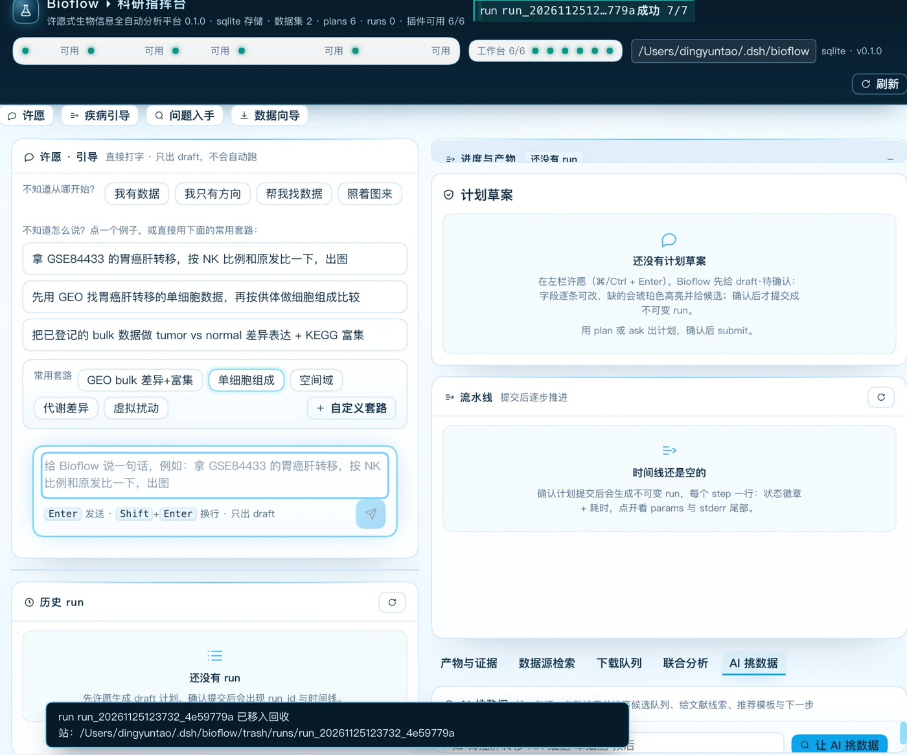
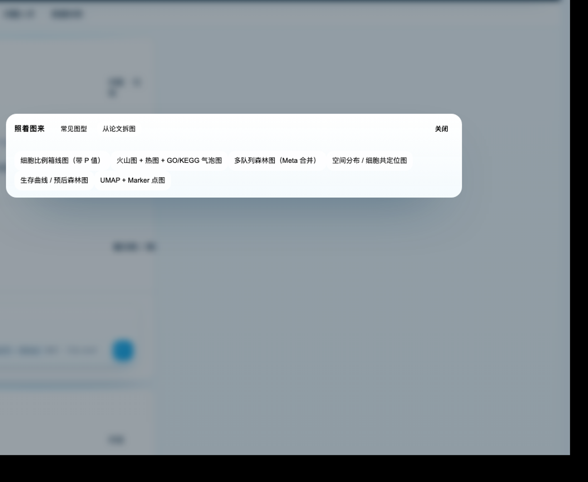
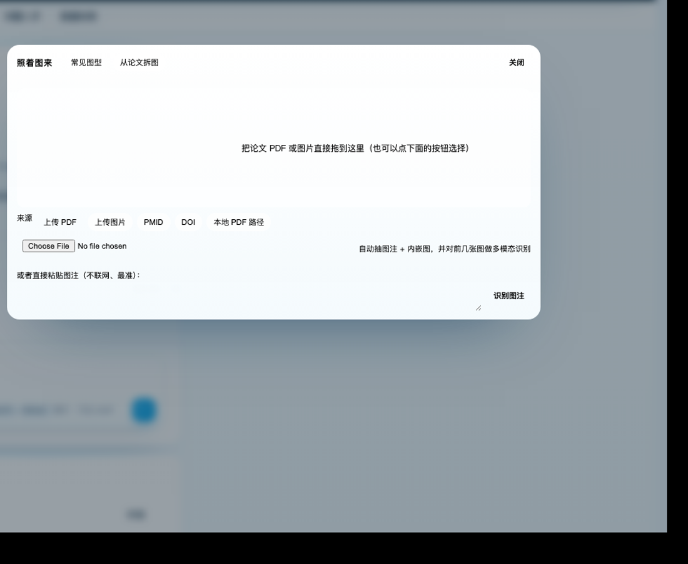
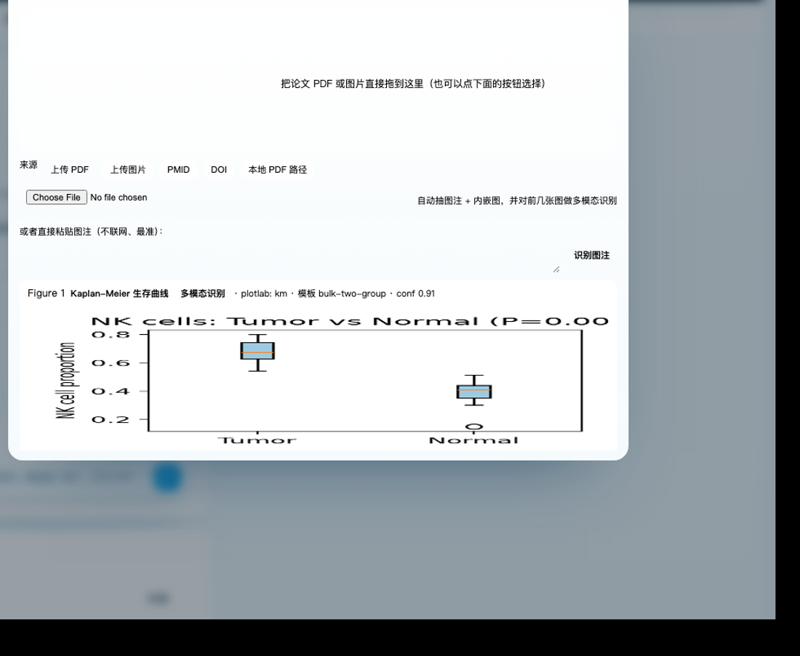

# 许愿式生物信息全自动分析平台 · 使用手册

版本：v0.2.1 ｜ 更新：2026-11-26 ｜ 入口：左侧栏「许愿式生物信息全自动分析平台」

> 一句话：**在许愿框说人话 → 系统给候选数据（中文摘要）→ 生成 draft 计划（字段都可改）→ 你确认 → 跑成不可变 run → 出图出表出证据。**
> 论文图复现：**照着图来 → 从论文拆图 → 拖 PDF / 点上传 PDF → 多模态识别 → 按这张图许愿。**

---

## 0. 30 秒版

1. 点左侧栏进入插件 → 顶部选「**许愿**」。
2. 在左下框里打一句话（示例：`拿 GSE84433 的胃癌肝转移，按 NK 比例跟原发灶比一下，出图`），按 **Enter**。
3. 弹出「候选数据集（中文摘要）」→ 选一个 → 右侧「计划卡」检查 → 点「**确认并运行**」。
4. 跑完在「产物与证据」看图表和证据；点「**导出结果包**」。

想复现论文里的图：顶部→「许愿」→「**照着图来**」→「**从论文拆图**」→ 把 PDF 拖进去（或点「上传 PDF」）。

---

## 1. 主流程：许愿



*图 1：许愿台。左侧是许愿卡（四个起手式 + 输入框 + 历史 run / 回收站），右侧是计划卡与产物区。*

### 1.1 在哪儿许愿

- 左侧栏进入插件后，**顶部标签选「许愿」**。
- 左栏第一张卡片就是许愿台：
  - 四个起手式：**我有数据 / 我只有方向 / 帮我找数据 / 照着图来**
  - 输入框：直接打字，`Enter` 发送，`Shift+Enter` 换行
  - 「看示例 / 常用套路」：不会说时点开，点一个例子直接填进去

### 1.2 许愿后发生什么

| 阶段 | 你会看到 | 你要做什么 |
|---|---|---|
| ① 解析 | 左栏对话出现「已生成 draft 计划」 | 什么都不用做 |
| ② 候选数据 | 弹窗「候选数据集（中文摘要）」：来源/编号/物种/样本量/模态/分组/风险 | 点「用这个数据集出计划」或换一个 |
| ③ 计划卡 | 右侧计划卡：模板、比较方向、字段、绿/黄/红体检灯；缺字段时只问一个问题并给按钮 | 核对，改不对的地方 |
| ④ 提交 | 点「确认并运行」后生成 run id | 等运行 |
| ⑤ 结果 | 「产物与证据」出现 文件/图/证据；「进度与产物」显示步骤、图数、表数、证据数 | 点「导出结果包」 |

> 注意：draft 阶段**不会自动执行**；任何一步失败 run 状态是 `failed`，不会报成功。

### 1.3 三个快速入口（不想打字时）

- **我有数据**：跳到「数据向导」，从已登记数据里挑，自动给分组/对照提案。
- **我只有方向**：跳到「疾病引导」，填疾病 + 追加数据（同类型先去批次 / 不同类型一脉相承）。
- **帮我找数据**：直接生成「帮我找公共数据」的许愿，AI 给候选队列与中文摘要。

---

## 2. 论文图复现（重点）

### 2.1 入口

顶部「许愿」→ 左栏许愿卡下面点「**照着图来**」。



*图 2：「照着图来」弹窗。顶部有两个页签：**常见图型** / **从论文拆图**。常见图型适合“我知道要什么图”；从论文拆图适合“论文里有张图，我想做类似的”。*

### 2.2 从论文拆图：上传 PDF 或图片

点弹窗顶部的「**从论文拆图**」页签：



*图 3：「从论文拆图」面板。整块区域都是拖拽区；也可以点「上传 PDF」/「上传图片」选择文件。*

**三种投喂方式（任选）**：

1. **拖拽**：从 Finder 把 `.pdf` 或 `.png/.jpg/.webp` 直接拖到面板里（面板出现提示/变亮，松手即上传）。
2. **上传 PDF**：点「上传 PDF」→ 选文件。
3. **上传图片**：点「上传图片」→ 选论文里截出来的单张图。

也支持不用文件：

- **PMID**：输入 PubMed 编号（需 PMC 开放全文），如 `24089192`
- **DOI**：输入 `10.xxxx/...`
- **本地 PDF 路径**：输入绝对路径
- **粘贴图注**：把论文图注文字粘进「或者直接粘贴图注」框，点「识别图注」（不联网、最准）

### 2.3 识别结果怎么读



*图 4：PDF 拆解结果。每张图带缩略图、页码、图注、图型、模板、`plotlab` 图表、置信度，以及「按这张图许愿」按钮。*

每条结果包含：

- **图型**：KM / 森林 / 火山 / 热图 / UMAP / 富集 / ROC / 箱线 / 空间……
- **需要的数据**：如「带随访（时间+事件）的队列」「单细胞 + 细胞类型 + 供体」
- **建议模板**：`bulk-two-group` / `scrna-composition` / `spatial-domain` / `plotlab-figure`
- **多模态识别徽标**：表示这张图是真的被模型看过（不是只读图注）
- **「按这张图许愿」**：点一下就填进许愿框，之后照常出计划 → 确认 → 运行

### 2.4 边界（避免误用）

- 多模态看图**依赖当前选择的模型**：必须是支持图片输入的模型；不支持时界面会明确提示你去设置里切换，不会假装识别。
- **矢量图/扫描版 PDF** 抽不到位图时，会退化为图注拆解，并在结果里写明原因。
- 认不出来就是 `unknown`，不硬编图型。

---

## 3. 疾病引导

顶部「疾病引导」：

- 疾病是**自由输入**（任何病种/场景，不限于几个示例）。
- 选一个主数据（或从在线库搜）→「＋ 从本地已登记里追加」。
- 系统自动区分：
  - **同类型多个队列**（如两个 bulk）→ 标黄「需去批次」→ 一键「先去批次合并，再生成计划」
  - **不同类型**（bulk + 单细胞/空间/代谢）→ 标蓝「一脉相承」，给出映射/验证/正交的方案
- 最后生成一句计划许愿，回到许愿流程。

## 4. 问题入手

顶部「问题入手」：填疾病/现象 →「查文献与队列核实」→ 可选择「写入思路链」或「生成核实许愿」。
另有「给我几个选题」按钮：返回候选临床问题 + 近两年 PubMed 综述热点。

## 5. 数据向导

顶部「数据向导」：候选数据勾选（单独/联合）→ 每个数据集一页（分组/对照提案，只检查）→ 总结页 → 去批次合并或分别生成计划。

---

## 6. 常见问题

**Q：回收站在哪？**
顶栏右侧「回收站」按钮，或左栏「历史 run」面板里的「回收站」。可恢复（重建索引）或彻底删除。

**Q：删掉的 run 能恢复吗？**
能。删除只是移到 `trash/runs/<run_id>`；在回收站点「恢复」即可继续看结果/导出。

**Q：结果导出到哪？**
「进度与产物」里的「输出到」可填目录并保存；不填就默认 run 旁边。点「导出结果包」会带 `content_hash`。

**Q：上传 PDF 没反应/拖不动？**
先确认在「从论文拆图」页签里操作；浏览器刷新到最新版；PDF 不超过 80 MB，图片不超过 12 MB。仍不行就把控制台报错发我。

**Q：模型不支持图片？**
设置 → 模型 → 选一个支持图片输入的多模态模型（如 deepseek V4 多模态），再回来试。

**Q：数据根在哪？**
默认 `~/.dsh/bioflow`，顶栏可看到当前路径。

---

## 7. 安装与更新

合集仓库：<https://github.com/jszjdyt/bio-wish-machine>，主开发仓库：<https://github.com/jszjdyt/dsh-bioflow>。

```bash
# 首次
cd 万能生信许愿机 && bash install.sh   # 然后 ⌘Q 完全退出 DSH 再打开

# 更新：同步插件目录后重跑 install.sh
```

---

## 附录：命令行（与界面同一套实现）

```bash
node bin/bioflow.mjs status --json
node bin/bioflow.mjs ask --query="用我的数据做差异分析并出图" --json
node bin/bioflow.mjs paper-pdf --pdf-path=/abs/paper.pdf --json
node bin/bioflow.mjs paper-figures --paper-pmid=24089192 --json
node bin/bioflow.mjs figure-from-image --image-path=/abs/figure.png --json
node bin/bioflow.mjs trash --trash-op=list --json
```
